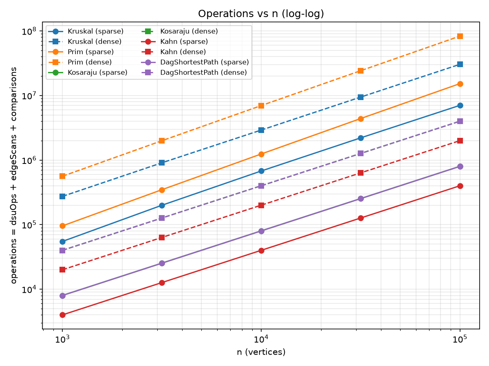
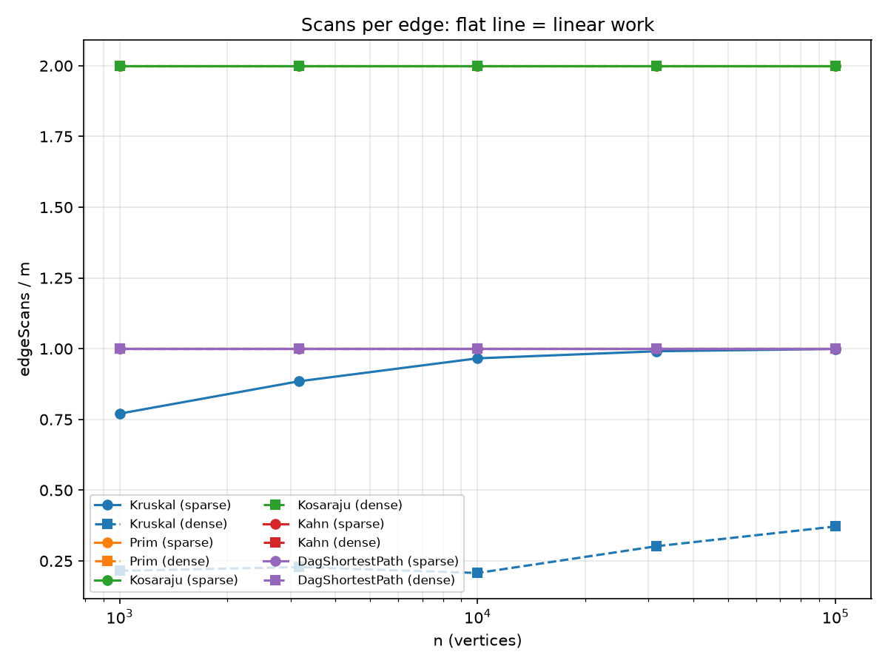
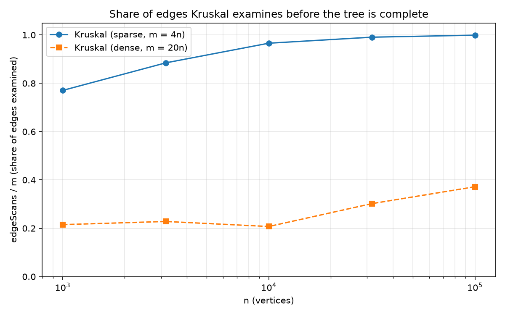

# Report - Assignment 3: DSU, MST, SCC and Shortest Paths

All numbers below come from `results/results.csv` (seed 42, reproducible with `mvn -q compile exec:java`). The benchmark checks all 10 reference values (MST weight, SCC count, sum of DAG distances) automatically and they all match exactly. Machine for the times: *13th Gen Intel(R) Core(TM) i7-13620H (2.40 GHz) 16.0 GB*.

## 1. Complexity table

V = vertices, E = edges.

| Algorithm | Time | Extra space | Justification |
|---|---|---|---|
| DSU `find` / `union` | O(alpha(n)) amortised | O(n) | `parent[]` and `rank[]`; union by rank keeps trees O(log n) high, path compression flattens them; together the amortised cost is the inverse Ackermann function (<= 4 for any real n). `find` is iterative. |
| Kruskal | O(E log E) = O(E log V) | O(E + V) | Sorting E edges costs E log E; then at most E `find` pairs and V-1 `union`s at O(alpha) each. The sorted copy of the edge list is O(E), DSU is O(V). |
| Prim (lazy, binary heap) | O(E log E) = O(E log V) | O(E + V) | Every adjacency entry is scanned once (2E) and may push one heap entry (heap size <= 2E), each push/poll is O(log E). `inTree[]` is O(V). |
| Kosaraju | O(V + E) | O(V + E) | Two DFS passes, each vertex pushed once, each adjacency entry scanned once per pass (2E in total). The reversed graph needs O(V+E); explicit stack, `order`, `comp` need O(V). |
| Kahn | O(V + E) | O(V) | Each vertex enters the queue once, each edge decrements one in-degree once. Copy of in-degrees, queue and order: O(V). |
| DAG shortest paths | O(V + E) | O(V) | Topological order (O(V+E)) plus one relaxation of every edge (E). `dist[]`, `parent[]`, the order: O(V). |

## 2. Counters versus formulas

The counters are incremented inside the algorithms: `dsuOps` = find calls + successful union calls (a `union` calls `find` twice internally and these are counted too); `edgeScans` = edges looked at; `comparisons` = comparator calls (sorting and priority queue) or relaxations; `maxDepth` = deepest explicit stack (Kosaraju) or longest queue (Kahn).
Kosaraju scans exactly 2m, Kahn and the DAG relaxation exactly m, at every size (the benchmark asserts it).

Ratio counter / formula for n = 1 000 ... 100 000 (sparse m = 4n, dense m = 20n):

| counter / formula | density | n=1000 | n=3162 | n=10000 | n=31623 | n=100000 |
|---|---|---|---|---|---|---|
| Kruskal dsuOps / E | sparse | 2.290 | 2.519 | 2.682 | 2.732 | 2.748 |
| Kruskal dsuOps / edgeScans | sparse | 2.972 | 2.848 | 2.776 | 2.757 | 2.751 |
| Kruskal comparisons / (E log2 E) | sparse | 0.891 | 0.907 | 0.869 | 0.809 | 0.745 |
| Prim edgeScans / (V+E) | sparse | 1.600 | 1.600 | 1.600 | 1.600 | 1.600 |
| Prim comparisons / (E log2 E) | sparse | 1.830 | 1.867 | 1.900 | 1.929 | 1.946 |
| Kosaraju edgeScans / (V+E) | sparse | 1.600 | 1.600 | 1.600 | 1.600 | 1.600 |
| Kahn edgeScans / (V+E) | sparse | 0.800 | 0.800 | 0.800 | 0.800 | 0.800 |
| DagShortestPath edgeScans / (V+E) | sparse | 0.800 | 0.800 | 0.800 | 0.800 | 0.800 |
| Kruskal dsuOps / E | dense | 0.580 | 0.606 | 0.565 | 0.754 | 0.894 |
| Kruskal dsuOps / edgeScans | dense | 2.697 | 2.657 | 2.723 | 2.497 | 2.403 |
| Kruskal comparisons / (E log2 E) | dense | 0.903 | 0.846 | 0.784 | 0.720 | 0.666 |
| Prim edgeScans / (V+E) | dense | 1.905 | 1.905 | 1.905 | 1.905 | 1.905 |
| Prim comparisons / (E log2 E) | dense | 1.826 | 1.849 | 1.868 | 1.880 | 1.892 |
| Kosaraju edgeScans / (V+E) | dense | 1.905 | 1.905 | 1.905 | 1.905 | 1.905 |
| Kahn edgeScans / (V+E) | dense | 0.952 | 0.952 | 0.952 | 0.952 | 0.952 |
| DagShortestPath edgeScans / (V+E) | dense | 0.952 | 0.952 | 0.952 | 0.952 | 0.952 |

How to read it:
* **Kosaraju, Kahn, DAG**: the ratio is *exactly* constant (1.600 / 0.800 for sparse, 1.905 / 0.952 for dense - it is 2E/(V+E) or E/(V+E), which depends only on the density). This is the empirical confirmation of O(V + E).
* **Prim**: `edgeScans/(V+E)` is exactly constant, `comparisons/(E log2 E)` is nearly constant (1.83 -> 1.95 sparse, 1.83 -> 1.89 dense) and flattens out as n grows, which is what E log E predicts.
* **Kruskal**: `comparisons/(E log2 E)` is roughly constant (0.89 -> 0.75 sparse, 0.90 -> 0.67 dense; it falls slowly because the real sort uses fewer than log2 E comparisons per element on this data). `dsuOps / E` is *not* flat, and it should not be: Kruskal stops as soon as the tree has n-1 edges, so the number of examined edges is not proportional to E (see plot 3: 77% -> 99.9% of the edges in the sparse case, 21% -> 37% in the dense case). Dividing by what the algorithm actually looked at, `dsuOps / edgeScans`, gives a stable value of about 2.4 - 3.0 (each examined edge costs two finds, each accepted edge two more finds and one union).

## 3. Slope check (log-log)

Least-squares slope of log(counter) against log(n):

| algorithm | density | slope of edgeScans vs n | slope of total ops vs n |
|---|---|---|---|
| Kruskal | sparse | 1.055 | 1.052 |
| Kruskal | dense | 1.119 | 1.022 |
| Prim | sparse | 1.000 | 1.102 |
| Prim | dense | 1.000 | 1.085 |
| Kosaraju | sparse | 1.000 | 1.000 |
| Kosaraju | dense | 1.000 | 1.000 |
| Kahn | sparse | 1.000 | 1.000 |
| Kahn | dense | 1.000 | 1.000 |
| DagShortestPath | sparse | 1.000 | 1.000 |
| DagShortestPath | dense | 1.000 | 1.000 |

The traversals (Prim's scans, Kosaraju, Kahn, DAG shortest paths) have slope **1.000**, i.e. linear work. Kruskal is steeper: **1.055** (sparse) and **1.119** (dense) for `edgeScans`, because the share of examined edges grows with n - the effect of the E log E term and of the "stop at n-1 edges" rule together. Prim's *total* operations (scans + comparisons) have slope 1.10 / 1.09, the log factor of the heap.

## 4. Plots

1. `results/plots/1_operations_vs_n.png` - total operations (dsuOps + edgeScans + comparisons) vs n, one line per algorithm and density, log-log.
2. `results/plots/2_scans_per_edge.png` - edgeScans / m vs n. Flat lines for Prim (2), Kosaraju (2), Kahn (1) and DAG (1): linear work. Kruskal is below 1 and rises.
3. `results/plots/3_kruskal_edge_share.png` - share of edges Kruskal examines.

Plot 3 explains where each MST algorithm wins. On sparse graphs (m = 4n) Kruskal has to look at almost every edge (99% at n = 31 623), so its saving from early stopping is nil and the cost is the full sort. On dense graphs (m = 20n) it needs only 21-37% of the edges, because the n-1 lightest useful edges appear early in the sorted order; but with a full sort it still pays E log E comparisons. In our counts at n = 100 000 dense, Kruskal needed 27.9 M comparisons + 1.8 M DSU operations, lazy Prim 79.2 M comparisons + 4.0 M scans, so Kruskal wins on both densities in operations. Prim's advantage is structural, not visible in these counters: it needs no global sort and no edge list, it works on an adjacency list, and with an adjacency *matrix* the array version runs in O(V^2) which beats E log E on really dense graphs.

## 5. Correctness arguments

### Cut property (Kruskal and Prim)
A cut splits the vertices into S and V\S. Claim: if e is a lightest edge crossing the cut and A is a set of edges contained in some minimum spanning tree T that does not cross the cut, then A + e is also contained in some MST. Proof: if e is in T we are done. Otherwise T + e contains exactly one cycle, and this cycle crosses the cut at e and at least once more, at some edge f of T. Remove f: T' = T + e - f is a spanning tree, and w(e) <= w(f) because e is a lightest crossing edge, so w(T') <= w(T) and T' is an MST that contains A and e. **Kruskal:** when it takes the lightest edge (u,v) with find(u) != find(v), the cut (component of u, rest) is crossed by no edge of A, and (u,v) is the lightest edge crossing it (every lighter edge was already examined and either taken or rejected because its ends were already connected), so the edge is safe. Rejected edges close a cycle and are the heaviest on it, so they are never needed. **Prim:** the cut is (vertices in the tree, the rest); the tree edges do not cross it, and the heap returns the lightest edge crossing it, so each step adds a safe edge. Skipping an entry whose vertex is already in the tree just discards a stale edge that no longer crosses the cut. Both algorithms add safe edges only, so the result is an MST; therefore the weights are equal (the trees may differ when weights tie). On a disconnected graph the argument applies to every component separately, giving a minimum spanning forest.

### Induction on the topological order (DAG shortest paths)
Let v_1, ..., v_n be the topological order, so every edge goes from a smaller to a larger index. Claim: when we start processing v_k, dist[v_k] is already the length of a shortest path to v_k (from the virtual super-source, which has a 0-weight edge to every in-degree-0 vertex). Base: v_1 has in-degree 0 (nothing can come before it), dist = 0 is correct. Step: take any shortest path to v_k; its last edge is (v_j, v_k) with j < k. By the induction hypothesis dist[v_j] is final when v_j is processed, and processing v_j relaxed the edge (v_j, v_k), so dist[v_k] <= dist[v_j] + w. All edges into v_k come from earlier vertices and were all relaxed before v_k is processed, so dist[v_k] is the minimum over all of them, i.e. it equals the shortest-path length. Relaxations never go below the true distance (dist is always the length of some real path), so the equality is exact. One pass over the edges is therefore enough: O(V + E).

**Why negative weights are safe in a DAG but not in a general graph.** The proof above never uses the sign of a weight: it only uses that all predecessors of v are finished before v. Dijkstra is different: it finalises the vertex with the smallest tentative distance and relies on "a later edge can only make a path longer", which a negative edge breaks. In a general graph with a negative cycle, "shortest path" is not even defined (going around the cycle lowers the length forever), and Bellman-Ford needs V-1 passes (O(VE)). A DAG has no cycles at all, hence no negative cycles, and every vertex is finalised exactly once, in a fixed order.

## 6. Which algorithm when

| Situation | Choice | Why |
|---|---|---|
| MST, sparse graph (E ~ V), input is an **edge list** | Kruskal | Needs only the edge list and a DSU. Looks at nearly all edges anyway (plot 3), cost E log E. |
| MST, dense graph, input is an **edge list** | Kruskal | Examines only 21-37% of the edges (plot 3); in our counts 2.8x fewer comparisons than lazy Prim at n = 100 000 dense. |
| MST, graph stored as an **adjacency list** and grown from a start vertex (or online) | Prim | No global sort, no edge list needed; works from any start vertex. |
| MST, very dense graph given as an **adjacency matrix** | Prim with an array (O(V^2)) | E ~ V^2, so a heap or a sort cannot beat a linear scan per step. |
| Disconnected graph, spanning forest wanted | Kruskal or Prim (restart per component) | Both return a forest and the number of components instead of failing. |
| Directed graph, **cycles possible**, find deadlocked job groups | Kosaraju (or Tarjan) | O(V+E); each SCC is a group of jobs that wait for each other. The condensation is a DAG. |
| Directed graph, need an execution order, **cycle possible** | Kahn | O(V+E) and it reports a cycle (fewer than n vertices leave the queue) instead of a wrong order. |
| **DAG**, cheapest/fastest route, weights possibly negative | DAG shortest paths | One pass O(V+E); Dijkstra is not safe with negative weights, Bellman-Ford is O(VE). |
| General graph, non-negative weights | Dijkstra (not part of this assignment) | O(E log V); cannot use the DAG pass because of cycles. |
| General graph, negative weights | Bellman-Ford (not part of this assignment) | O(VE), detects negative cycles. |

## 7. Time (one paragraph)

Times in `results.csv` are the median of 5 runs. On the largest dense graph (n = 100 000, m = 2 000 000) they were: Kruskal 790 ms, Prim 2 054 ms, Kosaraju 626 ms, Kahn 76 ms, DAG shortest paths 187 ms; on the smallest graphs (n = 1 000, m = 4 000) every algorithm took 0.7-3.4 ms. In the large cases the order of the times agrees with the counters (Prim has the most operations and is the slowest, Kahn and the DAG pass have the fewest and are the fastest), but the times are not the main evidence. On the small graphs the clock mostly measures JIT warm-up and noise: for example Kruskal needs 22.3 ms on the dense n = 1 000 graph (20 000 edges) but only 15.9 ms on the sparse n = 10 000 graph (40 000 edges), and at sparse n = 10 000 Prim (13.7 ms) beats Kruskal (15.9 ms) although it performs almost twice as many operations (1.24 M against 0.68 M). Prim's time on the dense graphs grows 13x from n = 10 000 to n = 31 623 (89.7 ms to 1 205 ms) while its comparison counter grows only 3.5x (6.6 M to 22.9 M), and from n = 31 623 to n = 100 000 time grows only 1.7x (1 205 ms to 2 054 ms) while the counter grows 3.5x again; such jumps come from the size of the heap, garbage collection and cache misses, not from the algorithm. The numbers also depend on the CPU, the JVM version and background load, so another laptop would give other times. The operation counters are identical on every machine (the same counters were obtained on two different computers), so they are the evidence used for all conclusions above.